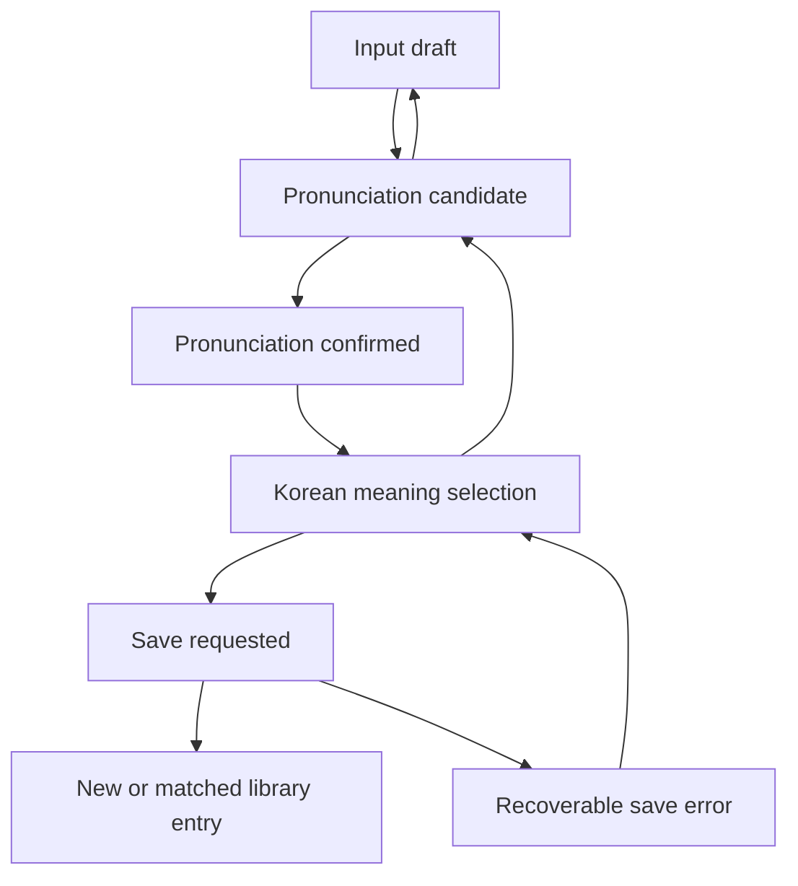
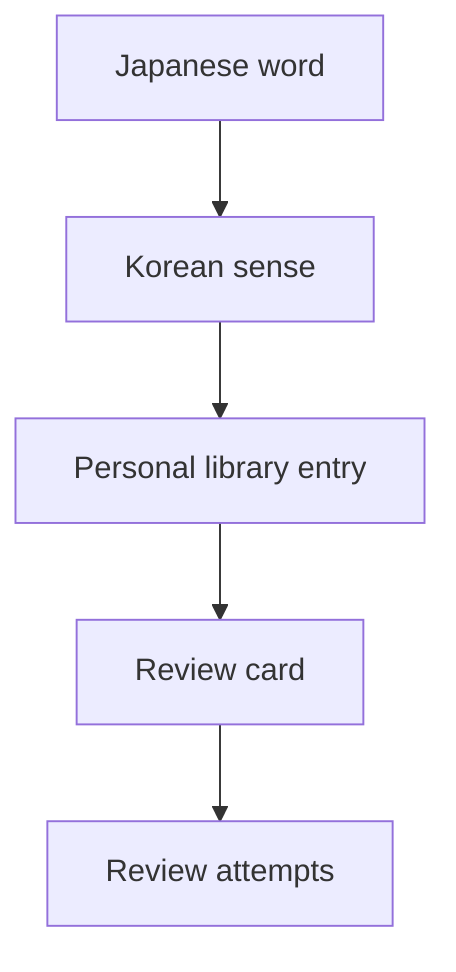
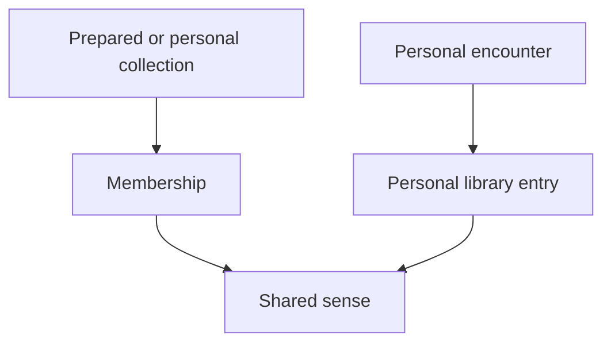

# Kotoba — shared project plan

Last updated: October 17, 2026.

This is the single maintained product plan for **both** kotoba-api and kotoba-web. It lives in the backend repository for version history; that location does not limit its scope to backend work. Repository READMEs own setup/API instructions; AGENTS.md files own coding guidance. Do not create another plan copy in the frontend or workspace root.

Status vocabulary: **implemented** means code exists; **verified** names checks actually performed; **planned** means not implemented; **open** requires a decision. Historical verification is not proof that a service is currently running.

## 1. Product requirements

### Purpose and languages

Build a personal, phone-first, Anki-like wordbook for learning **Japanese through Korean**. English is the interface language. Japanese is the target language; Korean is the language of meanings and explanations, not a second study-language option. Reading, conversation, and JLPT study all matter.

Two central requirements:

1. An interactive word-entry flow that confirms pronunciation and the particular Korean sense the user intends.
2. One personal library that combines prepared collections with personally encountered words while preserving context and learning progress.

### Main layout

The current proposed phone navigation is **Wordbook · Add · Review**, with settings behind a secondary entry. Navigation itself is not implemented. Earlier Today/Library/Add sketches are superseded by this direction; a separate dashboard is not required now.

- **Wordbook:** search and browse saved entries; open details to inspect pronunciation, selected Korean meaning, contexts, source/collection membership, and study state; edit without losing progress.
- **Add:** Japanese text or eventual speech → confirmed kana/pronunciation → intended Korean meaning and optional context. Save belongs on step three, never an additional mandatory enrichment screen.
- **Review:** eligible prompt → recall → reveal → self-rate → next card. Use an explicit completion state and actual schedule calculations.

Visual theme and layout may evolve independently of the backend contract. Prioritize narrow screens, reachable actions, keyboard/focus behavior, IME composition, readable Japanese/Korean text, long meanings, and non-color-only status feedback. Phone-specific validation is still needed.

### Product invariants

- Editing the word invalidates its reading, meaning, and pronunciation confirmation. Editing the reading invalidates confirmation and dependent meaning results.
- Generated/recognized values are suggestions until the user confirms them. Late responses must not overwrite newer edits.
- Manual correction remains possible when language services fail or suggest the wrong thing.
- A saved learning entry identifies an intended sense, not just a Japanese spelling or an exact Korean translation string.
- Multiple collection memberships and encounters must not multiply progress records or overwrite personal context.
- Importing prepared material must not automatically put every entry into active review.
- Saved, actively studying, and paused are distinct proposed states. Whether saving activates study remains open.
- Save/review retries must be safe; a retry uses the same operation ID, not a new learning action.
- Offline support must preserve pending actions across reloads before it is described as reliable synchronization.

### Scope boundaries

The first useful milestone is **save a manually entered word and find it in Wordbook after a reload**. The next complete learning loop adds basic recognition review. Voice, prepared collections, additional review modes, and offline synchronization follow in separate milestones.

Not required now: public profiles, payments, a deck marketplace, full Anki compatibility, native mobile apps, or automated scoring of the user's spoken pronunciation. Do not infer speaking assessment from pronunciation confirmation.

### Selected architecture

| Area | Selected direction | Boundary |
| --- | --- | --- |
| Frontend | Next.js App Router, React, TypeScript, plain CSS | English UI; Japanese/Korean learning content |
| Backend | Dedicated Go service using Gin | Owns validation, future storage, scheduling, and provider integrations |
| Database | MongoDB using the official Go driver | Local Compose setup first; hosting later |
| Repositories | Separate kotoba-web and kotoba-api Git repositories | Each has its own commits, remote, README, and agent instructions |
| Local API access | Next.js rewrite to Go | Transport proxy only; no second business-logic backend |

No auth, hosting, dictionary, speech, audio, or scheduling provider/algorithm has been selected. MongoDB does not provide the application's offline synchronization automatically.

### Learning objective

The user wants to read and assess code, especially idiomatic Go and Gin, while using AI to help implement it. Work in small inspectable features, explain inputs/outputs, decisions, side effects, and failure behavior, then inspect a test.

Immediate reading sequence: vocabulary validator → Gin handler → behavioral tests → MongoDB connection lifecycle. Ask the user to predict a concrete behavior and resolve misunderstandings before advancing. Do not substitute large autonomous feature batches for this learning goal.

## 2. Current implementation

### Active workspace

```text
kotoba/
├── kotoba-api/            # Backend Git repository
│   ├── docs/project-plan.md  # This shared plan
│   ├── cmd/api/
│   ├── internal/
│   ├── scripts/
│   └── compose.yaml
├── kotoba-web/            # Frontend Git repository
│   └── src/
├── README.md              # Local workspace guide, not a second plan
└── Makefile               # Delegates commands into the repositories
```

GitHub: [backend](https://github.com/pxyxyrus/kotoba-api) and [frontend](https://github.com/pxyxyrus/kotoba-web). The former apps/, github/, unused wordbook starter, archive, and compatibility links have been removed. Do not recreate duplicate working copies. Each active repository retains its original logical commit sequence.

### Implemented versus pending

| Capability | Actual status |
| --- | --- |
| Responsive frontend | Implemented; desktop appearance inspected; phone viewport checks pending |
| Three-step typed entry | Implemented with manually entered Japanese, kana confirmation, Korean meaning, and optional context |
| Edit invalidation | Implemented; reading edit clears confirmation; no automatic provider results exist yet |
| Go API validation | Implemented; form reaches the real API and shows loading/errors |
| Durable saving | **Not implemented**; successful validation explicitly returns persisted=false |
| Frontend draft retention | In-memory only; reload loses the draft |
| Backend liveness | Implemented at GET /healthz |
| Database connection/readiness | Optional URI, bounded startup check, reused client, shutdown cleanup, GET /readyz implemented |
| Local MongoDB service | Compose file prepared with loopback binding and persistent volume; live verification pending |
| Database collections/indexes | Not initialized; word schema and retry-safe indexes remain proposals |
| Wordbook navigation/list/search/edit | Not implemented |
| Review cards and scheduler | Not implemented |
| Speech/audio/reading lookup/meaning suggestions | Not implemented |
| Prepared collection imports and overlap handling | Not implemented |
| Authentication, deployment, offline sync, export | Not implemented |

MongoDB setup is blocked by the local environment: Docker CLI exists, but the engine was unavailable and the installed application failed to launch. A successful Compose configuration check does not establish a running database. Validation-only mode remains usable without a URI. Configuring an unreachable database causes API startup to fail; /readyz returns 503 when unconfigured or unavailable. Consult the backend README for commands.

### Verification record

- Backend foundation: build, vet, race tests, Staticcheck, and Compose configuration checks passed. Latest recorded govulncheck after dependency fixes reported zero reachable findings, with one imported-package and one required-module finding outside detected calls. These are historical results, not a permanent clean-dependency claim.
- Frontend foundation: lint, TypeScript, and production build passed. Browser-to-Go validation and clearing confirmation on a reading edit were observed. Desktop layout was inspected; a full phone/IME/accessibility pass is pending.
- Frontend dependency audit at installation: no production findings; five development-only findings in the lint dependency chain. Recheck when changing dependencies rather than treating this record as current audit data.
- Real MongoDB persistence, storage retry behavior, and multi-device synchronization have **not** been verified.
- Workspace consolidation preserved repository histories and remotes. It did not implement additional product features.

## 3. Next milestones

Work in this dependency order. These are feature gates, not promised dates. The former six-week sketch assumed near-full-time development and is superseded by learning-sized milestones; weekly availability has not been established.

| Milestone | Work | Completion evidence |
| --- | --- | --- |
| 1. Read existing Go code | Trace draft validation, handler mapping, and one failing/passing test | User can explain why a draft is accepted/rejected and identify where that behavior lives |
| 2. Run MongoDB | Resolve Docker environment; start local service; verify Go connection, readiness and shutdown | Real database ping succeeds; downtime produces the documented failure; no credentials logged |
| 3. Save one word | Finalize first document and retry contract; implement Go storage and save endpoint; connect step three | Save survives restart/reload; same operation retry has one effect; different senses remain distinct; failure retains draft |
| 4. Browse Wordbook | List with bounded/paginated results, entry details, editing, and basic navigation | Saved item can be found, opened and edited; empty/error states are honest; phone flow works |
| 5. Basic recognition review | Choose scheduler/rating semantics; implement cards, due selection and review events | Reveal/rate produces a real next due time; retry cannot duplicate review; paused items excluded |
| 6. Assisted capture | Choose lexical/audio providers, then speech transcription; retain manual fallback | Reading/audio correspond; Korean senses are editable; denied mic, cancellation and stale results handled |
| 7. Prepared collections | Choose licensed sources/import format; preview matches and conflicts; retain provenance | Reimport is safe; same sense preserves progress; ambiguous senses are not silently merged |
| 8. Offline and backup | Specify local storage, event identity, conflict rules, and export/restore scope | Cached review and pending actions survive reload; reconnect has no lost/duplicate effects; export matches promised scope |
| 9. Additional modes and deployment | Listening/recall modes; access control and hosting; target-device refinement | Separate mode schedules; protected access; measured device behavior and documented limitations |

Milestones 6–9 may be reprioritized by the user. Do not infer permission to implement the entire roadmap from one milestone request. Resolve dependencies before claiming a feature complete.

### Next storage contract to decide

Proposed initial collection: kotoba.words. Minimum document: stable record ID, client operation ID, Japanese text, reading, confirmed Korean sense, optional context, schema version, and UTC timestamps. Proposed indexes: unique operation ID for retries and created-at/ID for stable listing. There is no uniqueness constraint on spelling, reading, or gloss alone.

Before implementing: define same-ID/different-payload behavior, safe retries after a lost response, list pagination, and how a provisional manual sense can later match prepared-source identities. This need not require every conceptual entity below to become a MongoDB collection immediately.

### Open decisions

- Canonical sense identity and conservative overlap resolution.
- Save-versus-activate behavior and new-word limits.
- Scheduler, ratings, timezone handling, and per-mode card policy.
- Dictionary, Korean explanation, pronunciation audio, and speech providers; licensing, privacy, retention, and costs.
- Prepared source formats and source-update policy.
- Offline scope, conflict reconciliation, backup media, and restore behavior.
- Authentication and hosting before use beyond the local development setup.
- Time available for development; no calendar delivery dates committed.

## Maintenance rules

Update this plan when a product decision, feature status, dependency order, or verification limitation changes. Record evidence in the same change as implementation where practical. A frontend milestone may require a companion documentation commit in kotoba-api. Both repositories link to this plan; neither keeps a snapshot copy. Preserve the distinction between requirements, proposals, code that exists, and behavior actually verified.

## Detailed design backlog

The following retained design sections preserve earlier reasoning and acceptance criteria. They describe the target behavior and proposed conceptual model, **not implemented database collections or completed features**. The current status table and milestone order above take precedence. Field names may be refined when an operation is implemented.

### The three-step add-word interaction

#### Step 1 — type or speak Japanese

Confirmed input modes:

- Type/paste Japanese text.
- Speak the Japanese word; the system transcribes it.

Expected system behavior:

- Retain the original input/transcript in the draft.
- Offer candidate interpretation when needed.
- Let the user correct transcription before proceeding.
- Treat a model or recognizer output as a suggestion, not an established fact.
- Handle no speech, denied microphone access, cancellation, unsupported recording, and failed requests without losing text.

Text support is the first implementation slice. Voice support remains part of the planned product, not a rejected requirement.

Open questions: supported utterance length, word versus full-sentence input, browser/device recording support, raw audio retention, and provider selection.

#### Step 2 — confirm pronunciation

Display:

- Proposed Japanese spelling where known.
- Editable kana reading.
- Pronunciation playback when available.
- An English action such as Confirm pronunciation.

The default interpretation discussed is: the app proposes a reading/audio; the user listens, checks it, and approves or corrects it.

**Do not implement speech scoring as an assumed requirement.** The user never confirmed that they want to repeat the word aloud for automatic pronunciation assessment.

Important behavior:

- Audio should correspond to the proposed/current reading; editing the reading must invalidate stale playback assumptions.
- Audio failure must be distinguished from an invalid word or reading.
- A confirmed sound does not necessarily establish the correct kanji or sense.
- Whether kana-only confirmation is allowed when audio is unavailable is a product decision. A proposed fallback is to allow explicit manual confirmation while clearly indicating that playback failed.
- Pitch accent is optional future enrichment, not a required confirmation field.

#### Step 3 — clarify the intended Korean meaning

Display a small set of distinguishable meanings in Korean, optionally with short Japanese contexts and Korean translations.

The user may:

- Select a candidate meaning.
- Refine the Korean wording.
- Choose Something else and explain the context.
- Supply a sentence encountered in real life.

Text clarification is enough for the first milestone. Voice-based contextual clarification was proposed, but exact input-language support is unresolved.

For ambiguous input, ask a targeted question instead of presenting an unwieldy dictionary dump. An example discussed was かける, whose interpretation depends heavily on context. It is an illustration, not a complete lexical model or production dictionary dataset.

The final saved object should prioritize the user's selected sense. Other senses may be available in details but should not all become the answer for one card.

#### Save

- Save belongs on the meaning screen; do not add another mandatory enrichment screen.
- Persist the Japanese form, confirmed reading, selected/refined Korean sense, and any supplied context.
- Resolve duplicates without resetting an existing entry's learning history.
- Distinguish newly created entries from matches to existing entries.
- Make repeat taps and network retries safe.
- Clear the draft only after durable save succeeds, or retain a visible pending state if later offline capture is supported.
- Whether Save also activates review is open. Do not silently couple the two states.

#### State model



Recommended draft state fields:

- Draft/session identifier.
- Original input and input method.
- Current candidate spelling and reading.
- Pronunciation confirmation and the revision it applied to.
- Meaning candidates, selected sense, and user-supplied Korean wording.
- Optional context.
- Current step and request/error state.
- Save operation identifier and resulting library entry ID when available.

#### Editing and stale-result rules

These are proposed implementation invariants necessary to make the three-step flow trustworthy:

1. Editing the initial input can invalidate pronunciation and meaning results.
2. Editing the reading requires renewed pronunciation confirmation and rechecking dependent meaning candidates.
3. Choosing a meaning may alter the appropriate kanji spelling. That alone does not require another user-facing step if the confirmed reading remains correct.
4. If a sense implies a different reading, return to pronunciation confirmation rather than silently changing it.
5. Late results from an older request must not overwrite a newer user edit.
6. An unconfirmed generated suggestion must never silently replace a confirmed value.
7. A draft is not a library entry and must not appear in the review queue.

### Prepared collections and personal discoveries

This is a central product requirement. Do not reduce it to a file-upload button with no overlap handling.

#### Conceptual distinction

- **Vocabulary identity:** a Japanese lexical item/reading and an intended sense.
- **Collection membership:** where that sense is included.
- **Personal entry:** what the user selected, refined, and chose to study.
- **Encounter/context:** where the user personally encountered it.
- **Review state:** how the user performs on a specific exercise for that entry.

These concepts must remain distinguishable even if a document database embeds some of them together.

#### Overlap example

The user saves 懐かしい from a show and selects a Korean meaning. Later, they add a prepared collection containing the same sense.

Desired result:

- Preserve the existing entry and its review progress.
- Add the collection membership/source association.
- Preserve the personal context and Korean wording.
- Avoid another review card merely because there is another source.

If the collection contains a different sense, keep that sense distinguishable. A spelling match alone is not enough to merge learning records.

#### Matching is a real unresolved problem

Do not use any of these as the sole semantic identity:

- Raw Japanese spelling.
- Kana reading alone.
- An exact Korean translation string.
- A language model's unreviewed assertion that two entries are equivalent.

Prefer stable source sense IDs where available; otherwise preserve provenance and use conservative matching with a user-visible resolution path for ambiguous cases.

Normalization can help find candidates, but must not erase meaningful spelling, reading, or sense distinctions. The exact lexical identity strategy is open.

#### Import behavior

Proposed flow:

1. Select a prepared source or supply a supported import.
2. Parse and validate it without mutating the entire library immediately.
3. Show new items, existing matches, ambiguous overlaps, and invalid rows.
4. Confirm the import scope.
5. Store memberships and provenance.
6. Let the user decide which entries enter active study.

A large collection must not automatically create an equally large due queue.

Prepared lists need a verified source, permissions/licensing suitable for use, and accurate labeling. No source was chosen. “JLPT list” is a category discussed by the user, not evidence of an official comprehensive vocabulary list.

#### Proposed new-word policy

- Review due cards before introducing new ones.
- Allow a bounded daily new-word count.
- Offer Learn next for personal discoveries.
- Fill other new-word slots from a selected prepared collection.

This policy has not been finalized. In particular, capturing a word should not automatically imply urgency or active study.

### Review and scheduling design

#### Initial recognition exercise

| Stage | Content |
| --- | --- |
| Prompt | Japanese spelling, optionally enough context to identify the intended sense |
| Recall task | Reading and selected Korean meaning |
| Reveal | Confirmed kana, Korean meaning, available example/context, pronunciation playback |
| Rating | Proposed Again / Hard / Good / Easy, subject to scheduler selection |
| Next | Record attempt and compute the next due time |

#### Sense ambiguity in review prompts

Separating senses in storage does not by itself make a review question unambiguous.

If the same Japanese spelling has several saved senses, a bare word on the front may admit several correct answers. Proposed remedies include a short sentence, a usage cue, or a card policy that deliberately accepts more than one meaning. Choose one before calling a sense-specific card correct or incorrect.

For the first milestone, use vocabulary/context where the intended recall task is clear. Do not mistake a valid alternate sense for failed learning.

#### Later practice modes

- **Listening:** audio first; recall Japanese content and Korean meaning; reveal text afterward.
- **Recall/speaking:** Korean meaning or a situation first; produce Japanese, then reveal a suggested answer and self-rate.
- **JLPT-oriented practice:** contextual selection or sentence completion is a later possibility, not a complete initial test engine.

Do not use exact string equality as the sole correctness rule for open-ended speaking/recall. Multiple expressions can be appropriate. Automated speech assessment is not required.

Each enabled mode needs its own schedule. Recognizing written Japanese does not establish that the same word can be understood by ear or produced spontaneously.

#### Scheduler boundary

Separate scheduling logic from screens and storage code.

Conceptual input:

- Previous card state.
- Rating.
- Review timestamp and elapsed time.
- Scheduler configuration/version.

Conceptual output:

- Updated card state.
- Next due time.
- An immutable review attempt record or equivalent auditable event.

No algorithm is chosen. Do not ship arbitrary intervals under the claim that an established spaced-repetition algorithm has been implemented. Select and verify the algorithm before deciding which scheduling fields are required.

#### Safe progress handling

- A repeated submission must not create two attempts for one user action.
- Adding another source/collection must not reset progress.
- Pausing an entry should prevent it from appearing in the due queue without deleting its history.
- Review history should grow as separate events rather than an unbounded array embedded in one vocabulary record.
- Store enough algorithm version/context to interpret schedule changes later.

### Conceptual data model

This model describes domain concepts. It does **not** require one SQL table per concept or one NoSQL document per concept.

IDs, timestamps, enum values, and field names below are proposed. They are detailed enough to guide implementation, but should be finalized after the storage and scheduler decisions.

#### Japanese word / lexical item

| Field | Purpose |
| --- | --- |
| `id` | Stable identity |
| `spelling_ja` | Japanese form shown to the user |
| `reading_kana` | Reading for this modeled lexical item |
| `audio_reference` | Optional reference to pronunciation audio |
| `source_reference` | Optional dictionary/source identity |

Open issue: one spelling can have several readings; a reading may be associated with a specific lexical item or sense. The earlier sketch used one reading per word record. Treat that as a simplification, not proof that all Japanese words fit it. Decide whether variants use separate lexical records or related reading records before broad dictionary imports.

#### Word sense / Korean meaning

| Field | Purpose |
| --- | --- |
| `id` | Stable sense identity |
| `word_id` | Associated lexical item |
| `meaning_ko` | Korean definition/gloss |
| `usage_note_ko` | Optional Korean nuance or usage explanation |
| `example_ja` | Optional initial example |
| `example_ko` | Optional Korean translation |
| `source_sense_id` | Optional identity supplied by a dictionary/list source |

One meaning can be phrased several ways in Korean. Do not treat a wording change as definitive evidence of a different sense, or equal wording as definitive evidence of the same sense.

#### Collection

| Field | Purpose |
| --- | --- |
| `id` | Collection identity |
| `title` | User-facing title |
| `kind` | Prepared or personal |
| `source` | Attribution and origin |
| `source_version` | Optional import/source version |

Collections group material. They do not own independent copies of all learning state.

#### Collection membership

| Field | Purpose |
| --- | --- |
| `collection_id` | Parent collection |
| `sense_id` | Included meaning |
| `position` | Optional stable order within a list |
| `source_item_id` | Optional original source identity |

The collection/sense pair should not be duplicated accidentally. The enforcement mechanism depends on the database.

#### Personal library entry

| Field | Purpose |
| --- | --- |
| `id` | Personal entry identity |
| `sense_id` | Selected intended sense |
| `personal_meaning_ko` | Optional user refinement, distinct from shared/source wording |
| `study_status` | Proposed saved / active / paused |
| `saved_at` | Capture/import time |
| `updated_at` or `version` | Proposed synchronization support |

For one personal library, the intent is one entry per sense. If accounts are later generalized, uniqueness becomes scoped to a user/library, not global across all users.

#### Personal encounter / provenance — refinement of the first sketch

The original diagram placed one `personal_context` string on the library entry. That is insufficient to preserve several encounters cleanly.

Proposed refinement:

| Field | Purpose |
| --- | --- |
| `id` | Encounter identity |
| `library_entry_id` | Personal entry |
| `context_ja` | Optional original Japanese sentence/context |
| `note_ko` | Optional personal Korean explanation |
| `source_label` / `source_url` | Where the user encountered it, when provided |
| `captured_at` | When it was captured |

This may be embedded for bounded data or stored separately. It is a design proposal to support the agreed mixed-source behavior, not a request for a new mandatory input step.

#### Review card

| Field | Purpose |
| --- | --- |
| `id` | Exercise identity |
| `library_entry_id` | Personal entry being practiced |
| `mode` | Recognition, listening, or recall |
| `due_at` | Next due time |
| `scheduler_state` | Algorithm-specific state; shape not chosen |
| `scheduler_version` | Algorithm/configuration provenance |

A card belongs to a personal sense and exercise mode, not to each source list. More than one template per mode is not required initially.

#### Review attempt / event

| Field | Purpose |
| --- | --- |
| `id` | Stable event ID, reused when retrying the same action |
| `review_card_id` | Reviewed exercise |
| `rating` | Chosen recall rating |
| `reviewed_at` | User action time |
| `received_at` | Proposed server receipt time for sync diagnostics |
| `previous_card_version` | Proposed conflict/reconciliation input |

Exact event fields depend on the scheduler and sync strategy. Keep event identity distinct from a network request attempt.

#### Add session / draft

| Field | Purpose |
| --- | --- |
| `id` | Draft identity |
| `input_method` | Text or voice |
| `input_text` | Original typed input or transcription |
| `candidate_spelling_ja` | Current proposed form |
| `candidate_reading_kana` | Current proposed reading |
| `pronunciation_confirmed_at` | Confirmation time, if confirmed |
| `confirmed_revision` | Proposed guard against stale confirmation |
| `chosen_sense_id` / `chosen_meaning_ko` | Selected existing sense or unresolved/manual meaning |
| `context` | Optional explanation/context |
| `step` | Input, pronunciation, meaning, saving, saved, or recoverable error |
| `library_entry_id` | Result after saving, otherwise absent |

Where drafts live is open: local-only temporary state, server-backed state, or both. Core durable library data must not depend solely on a transient draft.

#### Relationship overview





Small diagrams are intentional. The user found the original all-in-one entity diagram difficult to read.

#### Data invariants to enforce

1. Drafts and suggestions are distinguishable from confirmed library entries.
2. A library entry identifies an intended sense, not merely a spelling.
3. Repeated Save/import/review requests do not create duplicate effects.
4. The same sense can appear in several collections without multiplying progress records.
5. Personal edits do not silently overwrite prepared-source content.
6. A changed source does not silently rewrite confirmed user intent.
7. Review histories survive membership changes and pausing.
8. Imported data retains enough provenance to inspect its origin.
9. Provider secrets are never stored in client data or committed source.
10. Any deletion policy must distinguish removing a membership, removing a personal entry, and deleting shared vocabulary. Exact deletion behavior is open.

### Offline storage and synchronization

#### Planned initial offline boundary

- Existing downloaded/cached words can be reviewed offline once this milestone is implemented.
- Local review actions are recorded immediately.
- Pending actions are synchronized when connectivity returns.
- Interactive lookup, transcription, and language-model clarification may require internet initially.
- Unavailable audio should be shown honestly; not all cached words necessarily have downloaded audio.

Do not promise that every prepared collection or all media are automatically available offline.

#### Proposed local data categories

| Category | Example | Durability expectation |
| --- | --- | --- |
| UI preference | Last tab, dismissed hint | Device-local |
| Draft | Partially confirmed word | Survives ordinary app interruption if supported |
| Downloaded content | Vocabulary, selected audio | Available for intended offline use |
| Local learning state | Latest known card state | Supports offline review |
| Pending operations | Review events awaiting acknowledgment | Must not vanish on reload |
| Sync metadata | Cursor, versions, acknowledgments | Supports safe incremental synchronization |

#### Synchronization principles

- Generate stable operation/event IDs before sending.
- Retry the same operation with the same ID.
- Acknowledge individual accepted operations.
- Preserve unacknowledged work across restart.
- Keep an append-only history of review actions where practical.
- Do not resolve two-device review history by blindly replacing one whole document with the other.
- Define a deterministic rule for reconciling scheduling state from accepted events; exact ordering and clock-skew behavior remain open.
- Keep visible recoverable errors for persistent sync failure.

Multi-device offline review is harder than simply enabling a cache. If it is deferred, state that limitation explicitly rather than claiming complete synchronization.

#### Export/backup

Proposed export includes personal entries, senses/readings needed to interpret them, collection memberships, personal context, cards, and review history. The format must preserve IDs and relationships so it is more useful than a screenshot or a flat list of Japanese words.

Whether media is bundled or referenced and whether import/restore is included in the first backup feature remain open.

### Language service design and failure handling

#### Service boundaries

| Service | Input | Output | User confirmation |
| --- | --- | --- | --- |
| Speech recognition | Recorded Japanese audio | Editable transcript/candidates | Correction at input |
| Lexical lookup | Japanese form/reading | Candidate lexical entries and senses | Pronunciation and meaning steps |
| Pronunciation | Selected reading/form | Audio or unavailable status | User approves intended pronunciation |
| Meaning assistance | Reading, candidates, context | Korean choices/explanation | User selects/refines meaning |

Adapters should keep provider-specific payloads out of core UI and domain models. Avoid a generic framework larger than the actual services needed.

#### Quality principles

- Prefer source-grounded lexical information where available.
- Generated suggestions must remain editable and distinguishable from confirmed data.
- Do not manufacture confidence scores that look calibrated.
- Use context to resolve ambiguity, but do not infer certainty from a plausible sentence alone.
- Manual entry should remain possible when suggestions are missing or wrong.
- Check audio/reading consistency; speech synthesis may not always resolve Japanese ambiguity as intended.
- Explain operational failures in English; keep lexical explanations in Korean.

#### Recording and privacy decisions still needed

- Whether raw microphone audio is uploaded, retained temporarily, or stored long-term.
- Whether pronunciation audio is generated, licensed, cached, or fetched each time.
- What user context is sent to third-party services.
- Provider limits, retry behavior, and operating costs.

Do not retain raw recordings indefinitely by default merely because audio storage is available. Do not choose paid providers or claim free-tier sufficiency without checking current terms when selecting them.

### Acceptance checks

These are planned checks, not claims that tests exist or pass. Automate the important invariants after implementation; use focused manual checks for presentation and device behavior. Avoid tests that merely mirror code with no behavioral value.

#### Language and entry flow

- [ ] UI labels are English; Japanese entries are explained in Korean.
- [ ] There is no separate Korean study-language mode.
- [ ] Japanese IME composition does not trigger premature submission.
- [ ] Typed input can be corrected before confirmation.
- [ ] A reading can be edited and re-confirmed.
- [ ] Audio corresponds to the current candidate rather than a stale reading.
- [ ] Audio failure is recoverable and does not erase the draft.
- [ ] The chosen Korean sense can be refined manually.
- [ ] Ambiguous input does not silently lock in a spelling or meaning.
- [ ] Returning to an earlier step preserves useful input and invalidates only dependent confirmations.
- [ ] A late provider response cannot overwrite newer input.
- [ ] Save is on the meaning step; no extra mandatory enrichment screen exists.
- [ ] A failed save leaves the user's work recoverable.

#### Persistence and overlap

- [ ] A saved entry survives reload through the actual chosen persistence path.
- [ ] Double-tapping Save does not create duplicate entries.
- [ ] Retrying after a lost response returns the same logical result.
- [ ] A second source for the same sense preserves review history.
- [ ] A different sense of the same spelling remains distinguishable.
- [ ] Multiple personal contexts are not silently overwritten.
- [ ] Import preview reports invalid and uncertain entries before changing the library.
- [ ] Re-importing a collection is safe and does not duplicate memberships.
- [ ] Importing a large collection does not immediately schedule every entry.

#### Reviews and offline behavior

- [ ] Recognition hides the answer until reveal.
- [ ] A prompt supplies enough context when needed to identify the intended sense.
- [ ] Rating uses the selected scheduler and records one event.
- [ ] Paused entries do not appear as due.
- [ ] Collection changes do not reset card state.
- [ ] Separate exercise modes have separate scheduling state.
- [ ] Offline review works for material actually available locally.
- [ ] Pending events survive app restart.
- [ ] Reconnection does not lose or double-count events.
- [ ] Conflict handling matches the documented policy.
- [ ] Exported data is interpretable and includes the promised scope.

#### Voice, access, and interface

- [ ] Denied microphone access leaves typed capture usable.
- [ ] A bad transcript can be corrected before pronunciation confirmation.
- [ ] No speech, cancellation, and service failure produce useful states.
- [ ] The app is usable with long Korean meanings on narrow screens.
- [ ] Keyboard/focus behavior and touch targets are usable.
- [ ] Loading and empty states do not impersonate real user progress.
- [ ] Backend validation does not rely solely on client-side form checks.
- [ ] Personal data is protected by the chosen access model.
- [ ] No provider secret is shipped to the phone/browser or committed to source.
